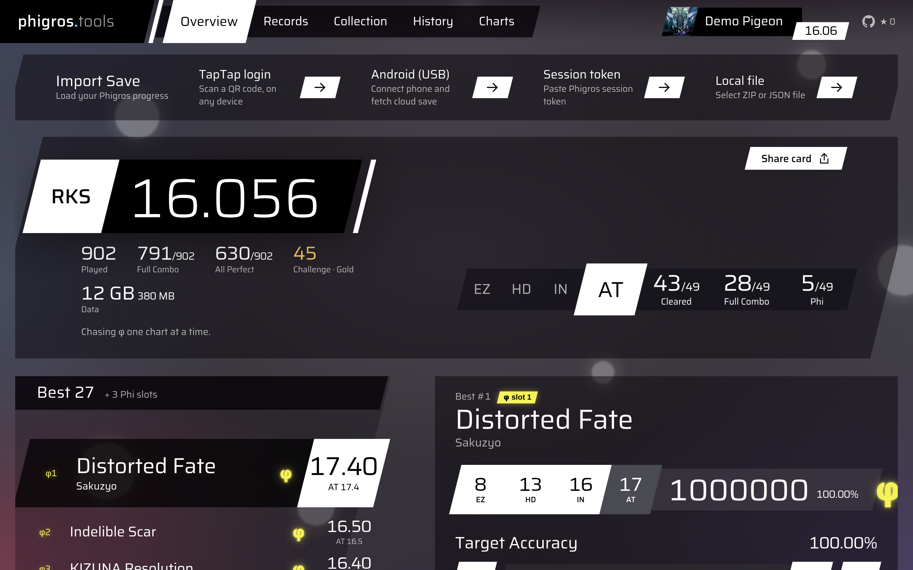
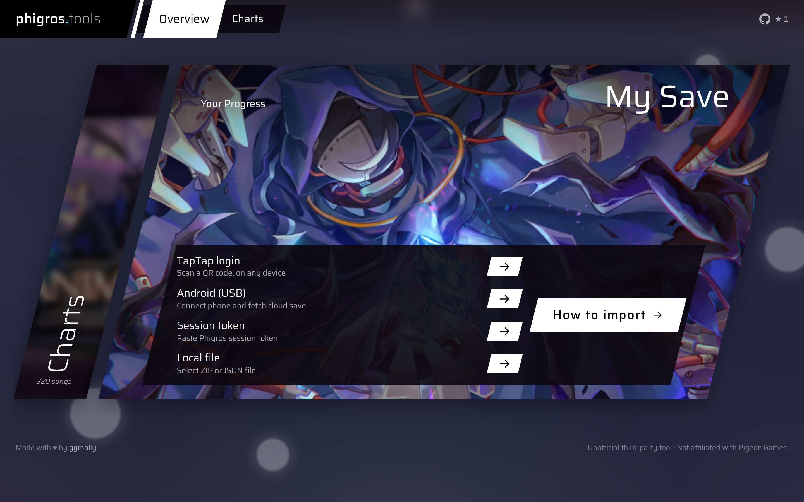
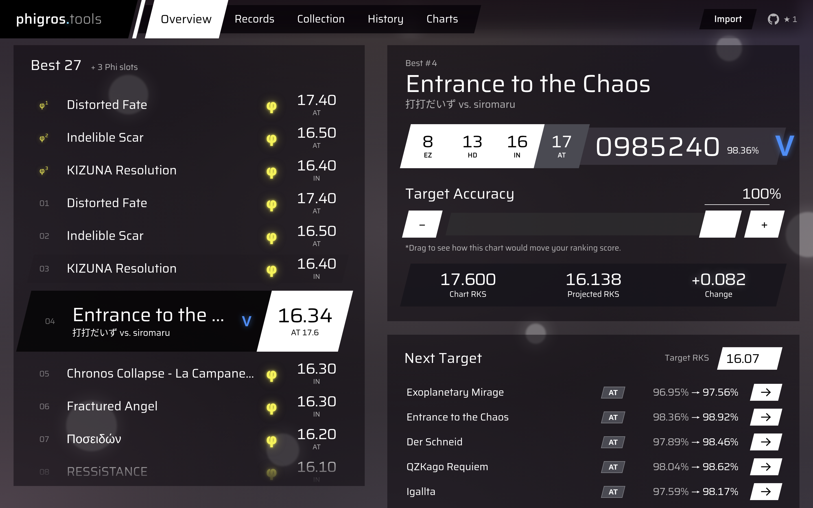
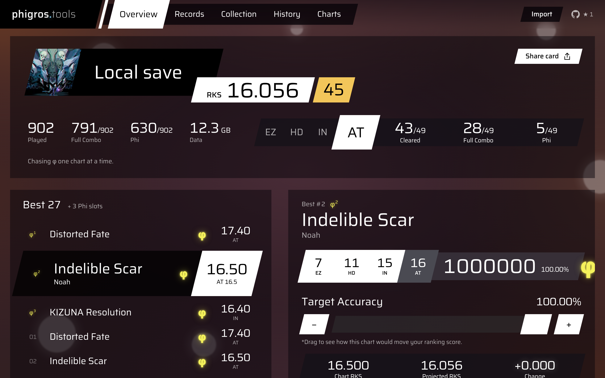
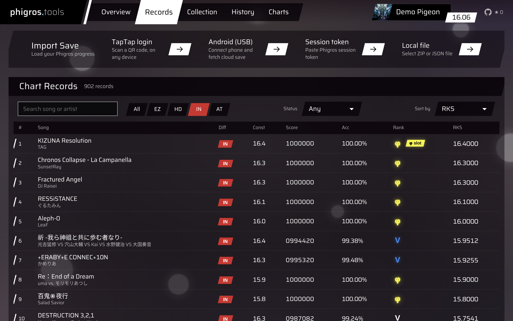
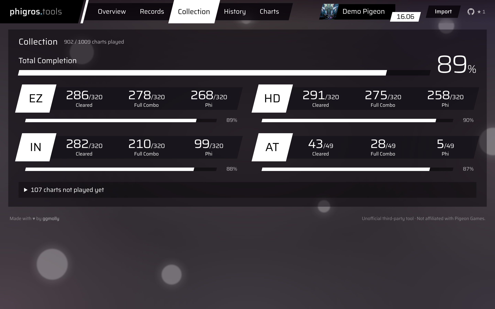
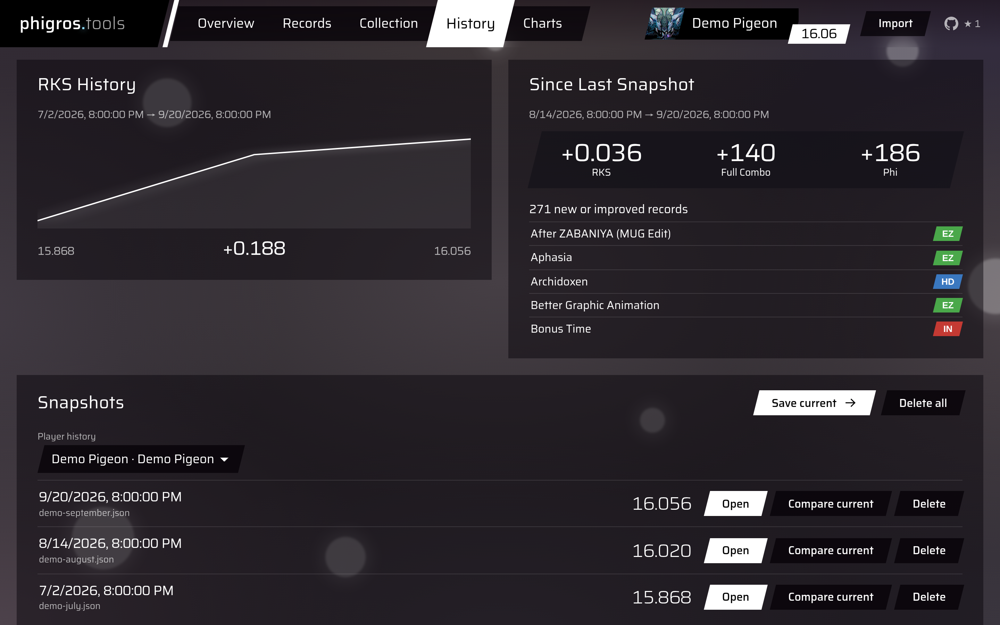
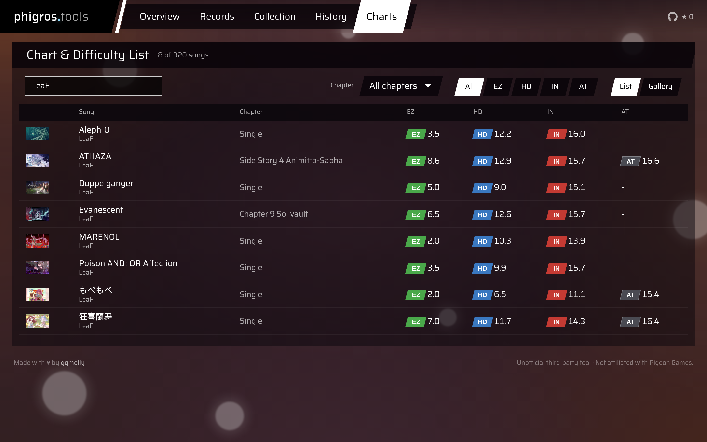
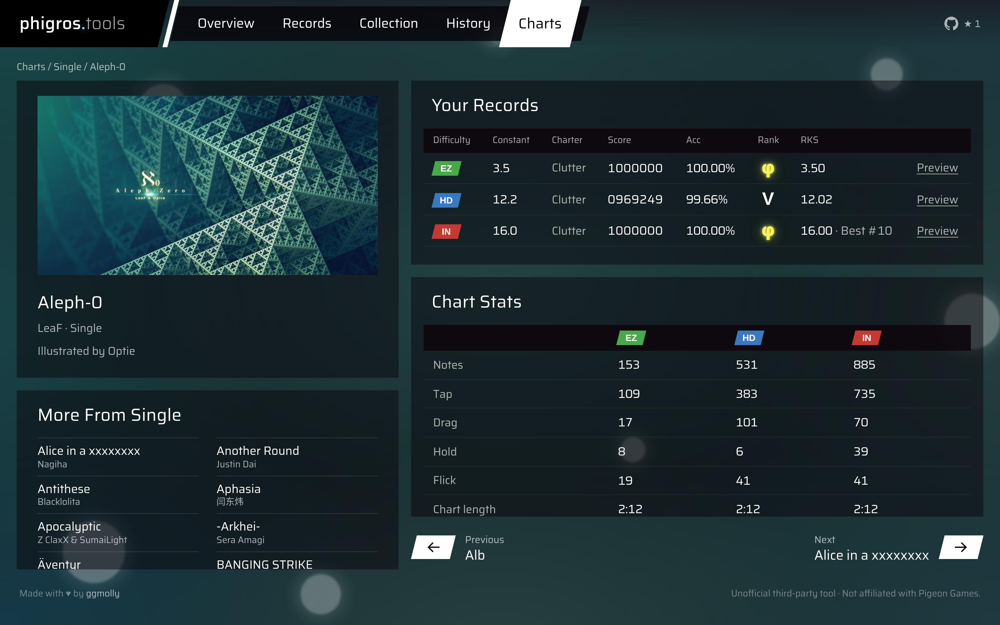
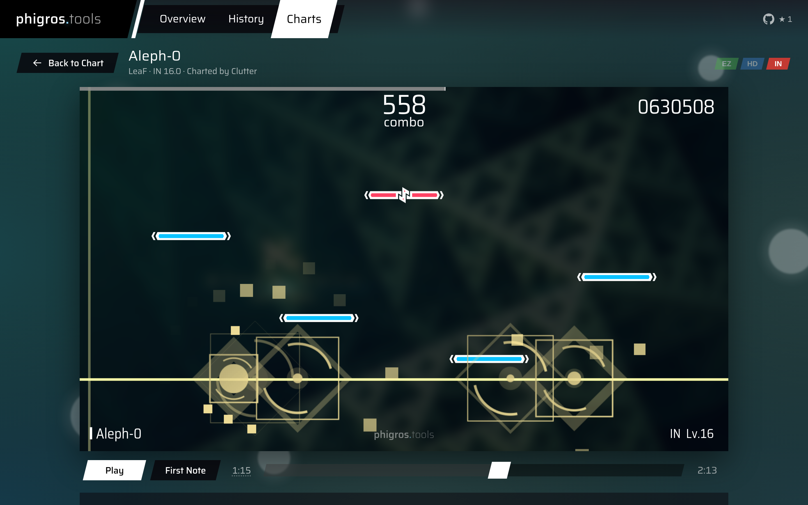

# phigros.tools

Analyze your Phigros save (ranking score, Best charts, records, progress) privately in your browser, and browse every chart's difficulty constant.



## Features

### Import a save

Log in with TapTap by scanning a QR code (any device, global or China version), connect an Android phone over USB, paste a session token, or open a ZIP/JSON save file. The main menu remembers every player you've synced before, laid out as a carousel like the game's own.



### Overview

Your RKS, played / Full Combo / All Perfect counts per difficulty, Challenge Mode rank, Data and self-intro, and your Best 27 + 3 Phi slots. Pick a chart and drag its target accuracy to see how it would move your ranking score; **Next Target** lists the charts closest to raising it.



The background fog takes on the colours of the selected song's cover.



### Records

Every chart you've played, searchable, filterable by difficulty and clear status (not FC, FC but not φ, φ), and sortable, including by how much an All Perfect would raise your RKS.



### Collection

Cleared, Full Combo and Phi progress per difficulty, plus the charts you haven't played yet.



### History

Save snapshots (stored in your browser) to chart your RKS over time and see what changed since the last one.



### Charts

The full chart list with difficulty constants, filterable by title, artist, illustrator, chapter and difficulty. No save needed.



Each song has its own page with your records on it when a save is loaded, charters, per-difficulty chart stats (note counts, density, BPM, scroll speed, judge lines…) and related songs.



### Play a chart

Watch any chart play out right in the browser from its **Preview** link, no save needed: adjustable speed and hitsound volume, and an optional local audio file to sync against. Share a link to a specific moment and it opens right there.



### Leaderboard

Players who sync from the game with [Phigros++](../mod) are ranked by RKS, and every chart has its own ranking, counting
all plays or verified replays only. A player's page is their profile: global rank, play count and time, notes hit,
accuracy, RKS history, top plays (with what each adds to their RKS), the ranks their new bests took, and recent plays,
with a **Watch** link on each verified one: the chart plays back with their fingers and their real judgements, score and
combo.

Records the game declares are marked **Imported**. An uploaded replay counts once the worker has judged it with a port
of the game's judgement (`src/judge.ts`) and its touches give the result the game recorded: it's then **Verified**, and
replaces an imported record of the same score, so a player can prove their records by playing them again. A replay that
gives another result doesn't count.

Links to a player or a replay show a preview on Discord and other apps, coloured like the song's cover: the player's
card (their RKS, counts and best charts), or the replay's (score, rank, accuracy and judgements), both drawn by
`server/card.tsx`.

Screenshots use a fictional demo save; regenerate them with `scripts/screenshots.ts` (see its header).

## Develop

```sh
bun install
bun run dev
```

Production: `bun run build && bun run start`, with the replay worker beside it: `bun .output/worker.mjs`. They share
`data/` and a RabbitMQ queue (`AMQP_URL`, `amqp://localhost` by default), and the worker reads charts from
`CHART_DIR` (`./public/chart-data`).

## Data

Songs, constants, charters, chapters, covers and chart stats all come from the game's APK. To refresh after a game update:

```sh
cd ../extract && .venv/bin/python export_game_info.py   # song database -> game_info.json
cd ../web && bun scripts/build-catalog.ts ../extract/game_info.json
```

The export reads the APKs' `assets/bin/Data` unzipped into `../extract/game_data/` (see the script's header). The other `scripts/build-*.ts` regenerate chart stats, covers, avatars, share-card fonts, palettes, accent colours and the sitemap; each file's header says what it reads.

## Credits

Saira, Noto Sans SC and Noto Sans Armenian fonts under the OFL, DejaVu Sans under its own license, see `LICENSES/`. The player cards use subsets of all four.

Unofficial third-party tool · Not affiliated with Pigeon Games.
